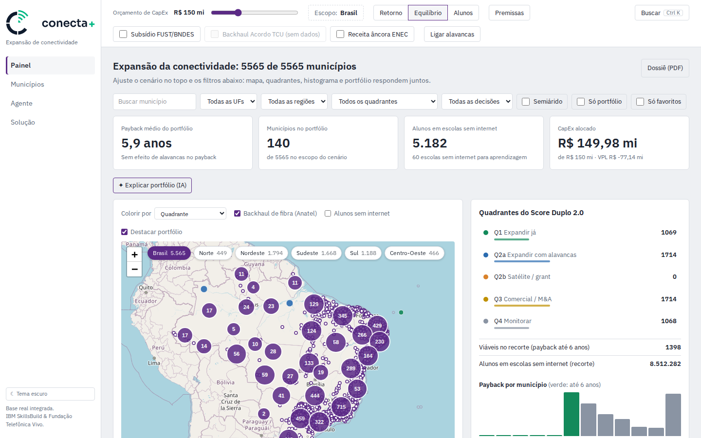

<p align="center">
  <picture>
    <source media="(prefers-color-scheme: dark)" srcset="SVG/conecta-vertical-escuro.svg">
    
  </picture>
</p>

# Conecta+ — Painel de Expansão de Conectividade

Sistema de apoio à decisão para expansão de conectividade da Vivo, desenvolvido para o **Desafio IBM SkillsBuild & Fundação Telefônica Vivo**.

> **Documentação do projeto, com telas:** [`docs/DOCUMENTACAO.md`](docs/DOCUMENTACAO.md)
> ([PDF](DOCUMENTACAO_CONECTA.pdf)). Conta o problema, a persona, as Hills, as decisões de produto e o que
> falta validar, seguindo o IBM Enterprise Design Thinking. Divisão de trabalho em [`TEAM.md`](TEAM.md).



---

## Estrutura do monorepo

```
conecta+/
  engine/          ← backend Python (FastAPI + PuLP)
  web/             ← frontend React (Vite + Tailwind + Leaflet)
  docs/            ← documentação técnica e planos de implementação
  SVG/             ← marca oficial: lockups horizontal e vertical, símbolo completo e pequeno (claro e escuro)
  TEAM.md
  PROPOSTA_CONECTA.pdf
```

---

## Pré-requisitos

| Ferramenta | Versão mínima |
|---|---|
| Python | 3.11 |
| Node.js | 18 |
| npm | 9 |

---

## Instalação

```bash
# Backend
cd engine
pip install -e ".[dev]"

# Frontend
cd ../web
npm install
```

---

## Rodar localmente

Abra dois terminais a partir da raiz do projeto:

**Terminal 1 — API (porta 8000):**
```bash
cd engine
uvicorn api.main:app --reload
```

**Terminal 2 — Frontend (porta 5173):**
```bash
cd web
npm run dev
```

Acesse `http://localhost:5173`.  
Sem o backend, o frontend (em localhost) carrega dados demonstrativos e mostra um aviso na tela.  
A documentação interativa da API fica em `http://localhost:8000/docs`.

---

## Testes

```bash
cd engine
python -m pytest
```

---

## Frontend — Views

| View | Descrição |
|---|---|
| **Painel** | KPIs animados, mapa Leaflet com todos os municípios (cor por quadrante, payback, score, alunos ou decisão), quadrantes, histograma de payback, explicação do portfólio e achados do cenário por IA ("O que eu não estou vendo?"), que seguem gerando se você trocar de aba, e dossiê do recorte em PDF |
| **Municípios** | Tabela ordenável com busca, filtros (inclusive por decisão), favoritos, portfólio e decisão vigente |
| **Agente** | Chat com o IBM Granite (watsonx.ai): ranking, portfólio, comparação, simulação de alavancas, menor orçamento para uma meta de alunos e dúvidas de uso; cenários calculados viram um botão "Aplicar no painel"; a conversa continua ao trocar de aba ou recarregar a página |
| **Solução** | Arquitetura IBM watsonx, ROI estimado e fases de entrega |

**Atalhos:** `Ctrl+K` abre a paleta de comandos. O cenário (orçamento, objetivo, alavancas, filtros), a aba e a ficha aberta ficam na URL, então recarregar mantém a tela e o link pode ser compartilhado, ex.: `/?uf=BA&semiarido=1&orcamento=150`. Clique em qualquer município para abrir a ficha executiva: situação no plano (por que entrou ou ficou fora e o que mudaria), registro de decisão do gestor, diagnóstico e business case.

---

## Arquitetura

```
web/src/
  pages/
    PanelView.tsx       ← painel principal: KPIs, mapa, quadrantes, histograma
    MunView.tsx         ← tabela de municípios com filtros completos
    ChatView.tsx        ← interface de chat com agente IA
    SolutionView.tsx    ← arquitetura, ROI e fases de entrega
  components/
    MapContainer.tsx    ← Leaflet + OSM (sem chave de API)
    Drawer.tsx          ← ficha executiva por município
    Header.tsx          ← slider de orçamento + alavancas
    CommandPalette.tsx  ← paleta Ctrl+K
  store/
    appStore.ts         ← estado global (Zustand)

engine/
  api/              ← FastAPI (routers por domínio)
  conecta/
    data/           ← schema Pydantic + loader CSV/Parquet
    scores/         ← cálculo de M, I, C, A e quadrantes
    geo/            ← distâncias ao backhaul (haversine)
    financial/      ← CapEx, payback, VPL, sensibilidade
    optimizer/      ← portfólio MILP (PuLP + CBC)
    backtest/       ← backtest 2021→2025
  data/             ← SQLite do ETL (base real) e CSVs demonstrativos de fallback
  tests/            ← pytest
```

Veja [`docs/arquitetura.md`](docs/arquitetura.md) para detalhes completos.

---

## Endpoints da API

| Método | Rota | Descrição |
|---|---|---|
| `GET` | `/municipios` | Lista com scores calculados; filtros `?uf=` e `?quadrante=` |
| `POST` | `/scores` | Recalcula scores com pesos customizados |
| `POST` | `/financial` | Business case de um município (CapEx, payback, VPL) |
| `POST` | `/portfolio` | Portfólio ótimo sob restrição de orçamento (MILP); `incluir` simula forçar municípios |
| `POST` | `/decisoes` | Registra a decisão do gestor (aprovar, adiar, descartar) com motivo e cenário |
| `GET` | `/decisoes` | Decisão vigente por município ou histórico de um município |
| `POST` | `/chat` | Agente com IBM Granite e ferramentas do motor; devolve ações "Aplicar no painel" |
| `POST` | `/ia/justificativa` | Justificativa geral de um município no cenário (situação no plano e custo da exceção calculados no servidor) |
| `POST` | `/ia/achados` | Até 3 achados do cenário calculados pelo motor e redigidos pelo Granite, cada um com uma ação |
| `GET` | `/backtest` | Resultado do backtest 2021→2025 (precision, recall, F1) |
| `GET` | `/health` | Healthcheck |

Veja [`docs/api.md`](docs/api.md) para exemplos de request/response.

---

## Dados

A API usa a base real quando `engine/data/conecta_mais.db` (ou `CONECTA_SQLITE_PATH`) tem as
tabelas do motor; caso contrário cai nos CSVs demonstrativos de `engine/data/` e `GET /health`
informa `fonte_dados: "mock"`. Para gerar ou atualizar a base real:

```bash
cd engine
python -m etl.run_etl
```

O ETL grava num arquivo temporário e troca no final, então uma API em execução (`--reload`) nunca encontra o banco ausente. Se a API subir sem o banco, o log avisa que está usando dados demonstrativos; depois de rodar o ETL, reinicie a API.

| Campo | Fonte | Estado |
|---|---|---|
| `domicilios_urbanos`, `acessos_fibra`, `acessos_total_bl`, `area_km2`, `lat`/`lon` | IBGE e Anatel (densidade) | real |
| `tem_backhaul_fibra` | Anatel — backhaul (Base dos Dados) | real |
| `matriculas_*`, `alunos_maior_turno_est`, `escolas_sem_internet_aprendizagem`, `alunos_sem_internet` | INEP — Censo Escolar 2024 | real |
| `semiarido` | IBGE/SUDENE — delimitação do Semiárido 2022 | real |
| `renda_media`, `ivs` | média/IVS por UF (IBGE, IPEA) | aproximado |
| `elevacao_media_m` | SRTM 90m no centroide (OpenTopoData) | aproximado |
| `market_share_vivo_movel`, `hhi`, `ppp_share` | microdados Anatel por prestadora | neutro |
| `velocidade_medida_mbps` | NIC.br / Medidor Educação Conectada | neutro |
| `acordo_migracao`, `fust_elegivel`, `eace_escolas` | Acordo TCU, editais FUST, EACE | neutro |

Campos neutros têm o mesmo valor em todos os municípios e não diferenciam o ranking. Para preenchê-los,
coloque os CSVs descritos nos steps 6 e 8 em `engine/data/raw/` (`nicbr_velocidade.csv`, `acordo_migracao.csv`,
`fust_municipios.csv`, `eace_municipios.csv`), apague o cache do step correspondente (`.parquet` na mesma pasta)
e rode o ETL de novo. A tabela `data_quality` do banco registra o estado de cada campo.
