<p align="center">
  
</p>

# Conecta+ — Documentação do projeto

**Desafio IBM SkillsBuild & Fundação Telefônica Vivo** · novembro de 2026

Este documento conta a história do Conecta+ pelo **IBM Enterprise Design Thinking**: o problema que
observamos, para quem resolvemos, as decisões que tomamos e o que ainda falta validar. Todas as telas
são do app rodando sobre a base real (IBGE, INEP e Anatel). Os detalhes técnicos estão nos documentos
de referência citados ao longo do texto.

---

## Sumário

0. [Resumo em 1 minuto](#0-resumo-em-1-minuto)
1. [Como usamos o Design Thinking](#1-como-usamos-o-design-thinking)
2. [Observar: o problema](#2-observar-o-problema)
3. [Refletir: para quem](#3-refletir-para-quem)
4. [Fazer: ideias e decisões](#4-fazer-ideias-e-decisões)
5. [A solução, pela jornada da persona](#5-a-solução-pela-jornada-da-persona)
6. [Como funciona](#6-como-funciona)
7. [IA confiável](#7-ia-confiável)
8. [Limites e próximos passos](#8-limites-e-próximos-passos)
9. [Como rodar e equipe](#9-como-rodar-e-equipe)

---

## 0. Resumo em 1 minuto

**O que é.** Um sistema de apoio à decisão para a expansão de fibra da Vivo. Ele cruza potencial de
mercado, impacto educacional, custo de implantação e alavancas públicas (FUST, acordo de migração da
concessão, programas de conectividade escolar) e monta o melhor portfólio de municípios para um
orçamento. O IBM Granite, no watsonx.ai, explica os números e responde perguntas; quem calcula é o motor.

**Para quem.** A gestora regional de expansão: decide investimentos da sua regional, ouve "por que minha
cidade ficou de fora?" dos prefeitos e precisa defender cada decisão no comitê de CapEx.

**O que entrega hoje.**

- Painel com os 5.565 municípios da base real, mapa, quadrantes e portfólio ótimo por orçamento.
- Ficha executiva que diz se o município entrou no plano, por que não entrou e **o que mudaria para incluí-lo**.
- Registro de decisões (aprovar, adiar, descartar) com motivo, histórico e exceções ao plano.
- Dossiê do recorte em PDF para o comitê.
- Agente com IBM Granite que consulta o motor e a documentação (RAG), sempre com as fontes.

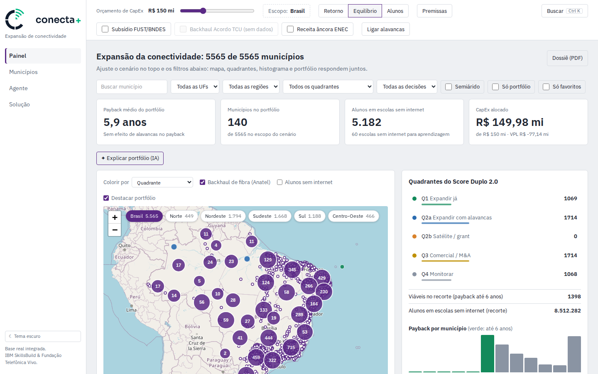

### Como avaliar em 5 minutos

Com o app rodando ([seção 9](#9-como-rodar-e-equipe)):

1. Abra `http://localhost:5173/?uf=BA&semiarido=1&orcamento=150`: o recorte e o orçamento de **R$ 150 mi** já vêm na URL.
2. Pressione **Ctrl+K**, digite "Juazeiro" e abra a ficha de Juazeiro (BA). Clique em **O que mudaria para incluir?**
3. Na mesma ficha, **Registrar decisão** → Aprovar, com um motivo. Veja o aviso de exceção ao plano.
4. Volte ao Painel e clique em **Dossiê (PDF)**.
5. Na aba **Agente**, pergunte: "Quais municípios do semiárido da Bahia têm mais alunos sem internet por real investido?"
6. Na aba **Solução** (`/?view=sol`), veja o estado de cada parte do sistema e os limites conhecidos.

### Estado das entregas

| Entregue | Parcial | Planejado |
|---|---|---|
| ETL em 12 passos sobre dados públicos e base SQLite | Tecnologia de acesso (custos de FWA e satélite ilustrativos) | watsonx Orchestrate |
| Scores M·I·C·A, quadrantes e business case | Construir × comprar (sem preço nem qualidade de rede) | watsonx.governance |
| Otimizador de portfólio (MILP) | Listas para secretarias (sem login nem contrato B2G) | IBM Decision Optimization (CPLEX) em produção |
| Situação no plano, simulação de inclusão, decisões e dossiê | Módulo Saúde (UBS como demanda, sem conectividade das UBS) | Uso sem conexão em campo (Hill 3) |
| Agente Granite com ferramentas, RAG e auditoria local | | Login e alçada por gestor |
| Backtest 2021→2025 com histórico real da Anatel | | |

---

## 1. Como usamos o Design Thinking

Seguimos o **IBM Enterprise Design Thinking**: três princípios, o Loop e três práticas-chave.

| Princípio | Como aparece no Conecta+ |
|---|---|
| **Foco no resultado do usuário** | Cada funcionalidade responde a uma Hill da gestora regional (seção 3), não a um módulo técnico. |
| **Reinvenção contínua** | O produto saiu de um protótipo HTML com dados simulados para um MVP com a base real; a persona mudou o foco de "painel analítico" para "decidir e defender" (seção 4). |
| **Times diversos e autônomos** | Três frentes com dono claro: algoritmos (scores, financeiro, otimização), produto (painel e ficha) e dados + IA (ETL e agentes). Veja [`TEAM.md`](../TEAM.md). |

**O Loop.** Observar → Refletir → Fazer, repetido a cada entrega. As seções 2 a 7 seguem esse ciclo e
a seção 8 traz os limites e os próximos passos.

**Práticas-chave.**

- **Hills:** três metas escritas do ponto de vista da gestora (seção 3).
- **Playbacks:** ainda não realizados; o primeiro, com gestores regionais, está nos próximos passos (seção 8).
- **Sponsor Users:** ainda **não** envolvidos. Persona, Hills e jornada são hipóteses construídas com
  dados públicos e com o enunciado do desafio. Validá-las é o primeiro passo do próximo ciclo.

Para quem conhece as cinco etapas clássicas, a correspondência é esta:

| Etapa clássica | No Loop | Onde está neste documento |
|---|---|---|
| Empatizar | Observar | [2. O problema](#2-observar-o-problema) |
| Definir | Refletir | [3. Persona, jornada e Hills](#3-refletir-para-quem) |
| Idear | Refletir / Fazer | [4. Ideias e decisões](#4-fazer-ideias-e-decisões) |
| Prototipar | Fazer | [4 e 5. Do protótipo ao MVP](#41-do-protótipo-ao-mvp) |
| Testar | Observar (de novo) | [8. Limites e próximos passos](#8-limites-e-próximos-passos) |

---

## 2. Observar: o problema

### 2.1 O que os dados públicos mostram

Sem acesso a usuários, começamos pelos dados. A proposta ([`PROPOSTA_DETALHADA.md`](PROPOSTA_DETALHADA.md), §2)
e a base montada pelo ETL apontam três tensões:

- **A fibra da Vivo chega a 453 cidades, cerca de 8% dos municípios.** A empresa investiu R$ 9,27 bilhões
  em 2025 (15,6% da receita) e declara foco em reduzir a intensidade de CapEx. Cada município escolhido pesa.
- **O gargalo da escola é a qualidade da conexão.** Na base do Conecta+, **46.357 escolas públicas (34% de
  137.755) não têm internet adequada para aprendizagem**, com 8,5 milhões de matrículas.
- **Os instrumentos públicos existem, mas são avaliados separadamente do plano comercial.** FUST (operado
  pelo BNDES), backhaul do acordo de migração da concessão (121 municípios) e a Estratégia Nacional de
  Escolas Conectadas (R$ 8,8 bilhões) atuam nas mesmas regiões, mas raramente entram na mesma conta.

| Indicador da base real | Valor |
|---|---|
| Municípios analisados | 5.565 |
| Escolas públicas sem internet para aprendizagem | 46.357 (34%) |
| Matrículas nessas escolas | 8.512.282 |
| Municípios com backhaul de fibra (Anatel) | 1.022 (18%) |
| Municípios no Semiárido (IBGE/SUDENE 2022) | 1.477 |

### 2.2 Quem é afetado

| Stakeholder | O que precisa |
|---|---|
| Gestora regional de expansão (Vivo) | Decidir onde investir e explicar cada decisão |
| Comitê de CapEx | Números que resistam a questionamento, com premissas explícitas |
| Relações regulatórias | Extrair valor comercial das obras obrigatórias do acordo |
| Fundação Telefônica Vivo | Levar formação docente para onde a conexão chega |
| Prefeituras e secretarias de educação | Entender por que o município entrou ou não |

### 2.3 A oportunidade

> Avaliar cada município com **todos** os instrumentos disponíveis: retorno privado, impacto educacional,
> custo de implantação e alavancas públicas. E deixar a decisão explicável para quem decide e para quem
> pergunta.

---

## 3. Refletir: para quem

Tudo nesta seção é **hipótese**, a validar com Sponsor Users (seção 8).

### 3.1 Persona: gestora regional de expansão

- **Quem é:** responde por uma regional (por exemplo, Nordeste e Semiárido), decide investimentos dentro
  de uma alçada e presta contas ao comitê de CapEx.
- **Onde trabalha:** boa parte do tempo em campo, com prefeituras e secretarias de educação, pelo celular
  e com sinal instável.
- **O que precisa:** explicar por que um município entrou ou não no plano, registrar a decisão com o
  motivo e levar ao comitê um material que resista a questionamento.
- **O que atrapalha:** números espalhados em planilhas, premissas implícitas, pressão local para incluir
  municípios e dados públicos incompletos.

**Mapa de empatia**

| Diz | Pensa |
|---|---|
| "Por que minha cidade ficou de fora?" (ouvido do prefeito) | "Se eu aprovar fora do plano, preciso de um motivo que o comitê aceite." |
| **Faz** | **Sente** |
| Monta planilhas próprias para cada visita e reunião | Insegurança quando um número não tem fonte clara |

### 3.2 Jornada atual (as-is)

| Etapa | O que a gestora faz | Dor |
|---|---|---|
| 1. Recebe a pergunta | O prefeito questiona por que o município ficou fora do plano | Não tem a resposta à mão; promete retornar |
| 2. Monta a análise | Cruza planilhas de mercado, custo e escolas, cada uma com uma data e uma premissa | Horas de trabalho; números que não batem entre si |
| 3. Avalia alavancas | Procura se o município tem FUST, backhaul do acordo ou programa escolar | Informação dispersa em editais e listas oficiais |
| 4. Decide | Aprova uma exceção ou mantém o plano | A decisão fica em e-mail ou reunião, sem registro do motivo |
| 5. Presta contas | Prepara material para o comitê de CapEx | Refaz a análise; premissas implícitas viram questionamento |

### 3.3 Hills

1. **Explicar:** a gestora regional explica pelo celular, em menos de 2 minutos, por que um município
   entrou ou não no plano e o que mudaria isso, com números de fonte rastreável.
2. **Decidir e defender:** a gestora regional registra a decisão (aprovar, adiar ou descartar) com motivo
   e observação de campo e sai, no mesmo dia, com o dossiê do recorte pronto para o comitê.
3. **Próxima, a validar:** a gestora regional consulta as fichas e registra decisões da sua região mesmo
   sem sinal, e tudo é enviado quando a conexão volta.

### 3.4 Premissas a validar primeiro

| Hipótese | Se estiver errada | Como validar |
|---|---|---|
| A gestora decide dentro de uma alçada, e não só recomenda | O registro vira proposta e precisa de um fluxo de aprovação | Perguntar a 3 gestores como uma expansão é aprovada hoje |
| A pergunta mais comum em campo é "por que ficou de fora?" | A situação no plano perde prioridade | Pedir os 5 últimos questionamentos recebidos de prefeituras |
| O uso em campo é no celular, com sinal ruim | A Hill 3 é desnecessária ou urgente | Perguntar o aparelho usado e acompanhar um dia de visitas |
| O comitê aceita o dossiê gerado pelo sistema | O dossiê precisa de outro formato ou de outros números | Mostrar um dossiê a quem participa do comitê |
| Motivo e observação de campo bastam para justificar | Faltam anexos, fotos ou assinaturas | Revisar 3 decisões reais com uma gestora |

---

## 4. Fazer: ideias e decisões

### 4.1 Do protótipo ao MVP

O primeiro protótipo foi uma página HTML com dados simulados de 417 municípios da Bahia: orçamento,
alavancas, mapa e quadrantes. Ele serviu para discutir a ideia central (alavancas mudam o quadrante de
um município) antes de existir base ou motor.

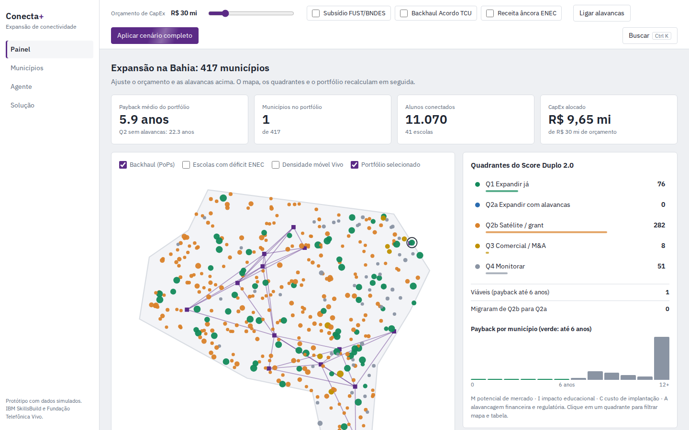

Do protótipo para o MVP, três mudanças vieram de reflexões do Loop:

- **Dados simulados → base real.** Um ETL de 12 passos integra IBGE, INEP, Anatel, CNES, Ipeadata, SRTM e
  IBGE/SUDENE. Campos sem fonte pública aparecem como neutros ou aproximados, nunca como dado real.
- **Cálculo na tela → cenário único no servidor.** Painel, tabela, ficha, PDF e agente usam o mesmo
  cenário calculado no backend. Antes, cada tela podia mostrar um número diferente para o mesmo município.
- **Painel analítico → decidir e defender.** A persona mostrou que ranquear não basta: a gestora precisa
  explicar, registrar e prestar contas. Daí vieram a situação no plano, a simulação de inclusão, o registro
  de decisões, o dossiê e a ficha no celular.

### 4.2 Necessidade → decisão de produto

| Necessidade da persona | Decisão de produto | Por quê |
|---|---|---|
| Responder "por que ficou de fora?" | Situação no plano em uma frase, com cinco motivos possíveis | A resposta tem que caber numa conversa com o prefeito |
| Saber o que mudaria a decisão | "O que mudaria para incluir?" recalcula o portfólio com o município forçado | Mostra o custo da exceção: quem sai, quantos alunos e quanto de VPL |
| Números que resistam ao comitê | Motor determinístico calcula; a IA só redige sobre os números do motor | Um texto pode errar a redação, mas não inventa o número |
| Confiar nos dados | Cada campo é rotulado como real, aproximado ou neutro, na tela e no PDF | Dado público incompleto não pode parecer dado medido |
| Registrar a decisão | Decisões no servidor, sem apagar o histórico; exceções ao plano marcadas | O comitê vê o que foi decidido, por quem e com qual cenário |
| Usar em campo | Ficha legível no celular e explicações das alavancas também no toque | A gestora passa boa parte do tempo fora do escritório |
| Considerar o dinheiro público | Alavancas FUST/BNDES, backhaul do acordo e receita âncora escolar no cenário | É a tese do projeto: expansão com alavancas |
| Equilibrar retorno e impacto | Objetivo do portfólio: Retorno, Equilíbrio ou Alunos | A escolha entre VPL e alunos conectados fica explícita |

---

## 5. A solução, pela jornada da persona

Os prints usam o mesmo cenário: **Bahia · Semiárido, orçamento de R$ 150 mi, objetivo Equilíbrio, sem
alavancas.** O recorte tem 287 municípios; o plano escolhe 27, usa R$ 149,79 mi e atende 21.918 alunos
em 188 escolas sem internet. As decisões mostradas foram registradas por um responsável fictício.

### 5.1 Ver o recorte

A gestora escolhe a região nos filtros ou nos botões sobre o mapa. Orçamento, objetivo, premissas e
alavancas ficam no topo e valem para todas as telas. O cenário, a aba e a ficha aberta ficam na URL:
recarregar a página não perde nada e o link abre a mesma tela para outra pessoa. Enquanto o plano é
recalculado, o topo mostra "recalculando…" e os KPIs ficam esmaecidos. O mapa mostra os quadrantes, o
backhaul de fibra e as bolhas de alunos sem internet; ao lado, a contagem por quadrante e o histograma de
payback.

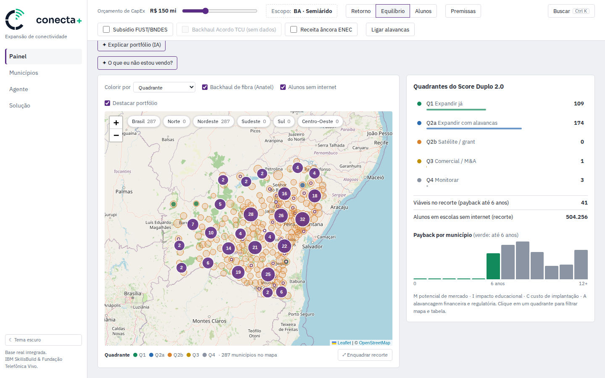

| Quadrante | Perfil | Ação |
|---|---|---|
| Q1 | M alto e I alto | Expandir já |
| Q2a | M baixo, I alto, com alavancas | Expandir com alavancas |
| Q2b | M baixo, I alto, sem alavancas | Satélite / grant |
| Q3 | M alto e I baixo | Comercial / M&A |
| Q4 | M baixo e I baixo | Monitorar |

No Painel, **O que eu não estou vendo?** pede ao motor o que pode ter passado despercebido no recorte e
ao Granite os três achados mais úteis, cada um com um botão que aplica a mudança ou abre a ficha. No
recorte acima: R$ 30 mi a mais trariam 6 municípios e 4.047 alunos; o FUST elevaria o VPL do plano em
R$ 45,74 mi; a receita escolar (ENEC) colocaria 8 municípios dentro do teto de payback.

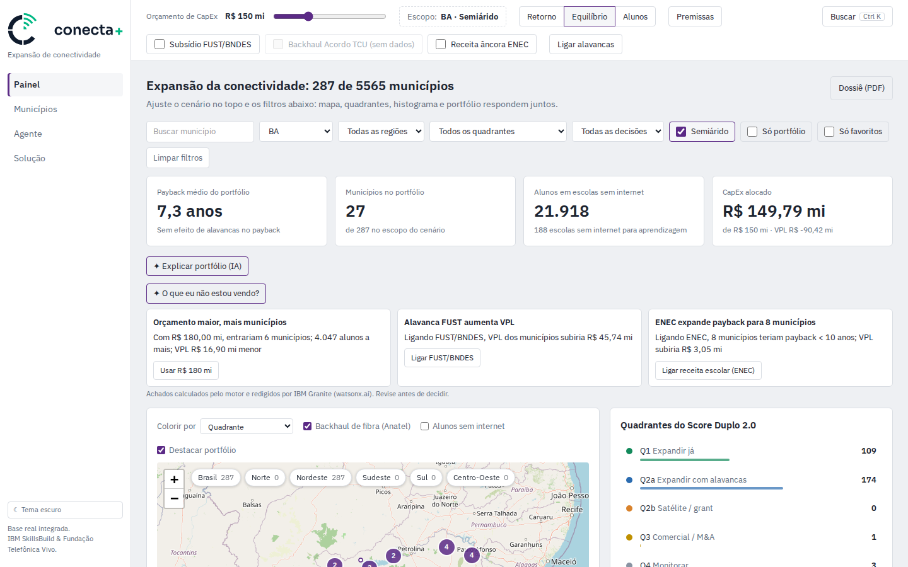

*Dor resolvida:* análise espalhada em planilhas (jornada, etapa 2).

### 5.2 Hill 1 — Explicar

O prefeito de Juazeiro pergunta por que a cidade ficou fora. A gestora abre a ficha: **"Ficou fora: custa
R$ 120,27 mi e sobram R$ 0,21 mi no orçamento."** Ao clicar em **O que mudaria para incluir?**, o sistema
recalcula o mesmo portfólio com Juazeiro dentro e mostra o preço da exceção: sairiam 20 municípios
(Antônio Gonçalves, Banzaê, Bom Jesus da Serra e outros), com 635 alunos atendidos a menos e VPL R$ 9,09 mi
maior.

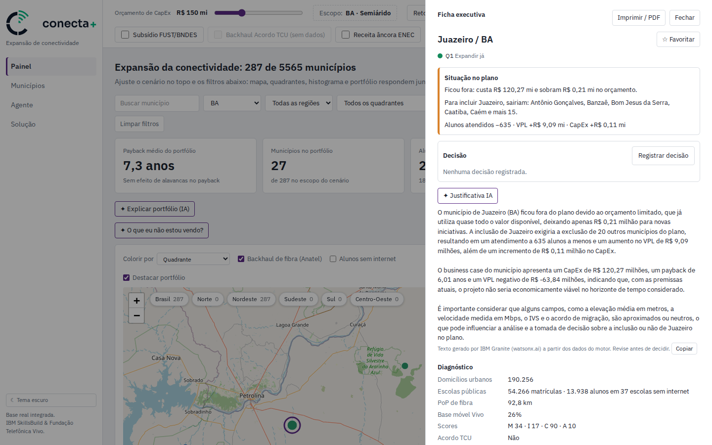

A ficha também traz diagnóstico (domicílios, escolas, distância ao backhaul, scores), plano de ação e
business case com e sem alavancas. O botão **Justificativa IA** pede ao Granite uma justificativa geral,
que serve para a gestora, o comitê ou a prefeitura: se o município entrou no plano e por quê, o que mudaria
isso (quem sairia do plano e quantos alunos e quanto de VPL a exceção custa) e os pontos de atenção. A
situação e a simulação são calculadas no servidor com o cenário da tela e chegam ao Granite como frases
prontas, com unidades; ele só redige, com temperatura 0 para não variar nem inventar. O texto vem
marcado como gerado por IA, tem um botão **Copiar** e fica guardado com a decisão e no PDF.

No celular, a mesma ficha cabe numa coluna, já com a decisão vigente:

<p align="center">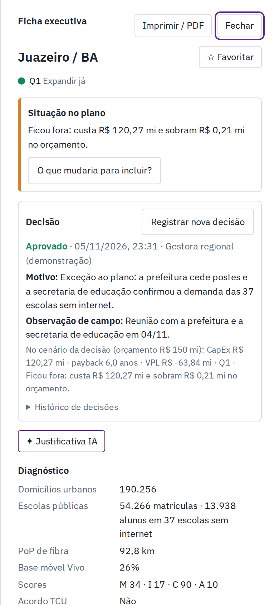</p>

*Dores resolvidas:* não ter a resposta à mão (etapa 1) e não saber quanto custa uma exceção (etapa 3).

### 5.3 Hill 2 — Decidir e defender

A gestora decide aprovar Juazeiro como exceção. O formulário pede o motivo (obrigatório), a observação
de campo e o responsável. Como o município está fora do plano, o sistema avisa que a aprovação fica
registrada como **exceção**. O cenário vai junto e o servidor recalcula CapEx, payback e VPL.

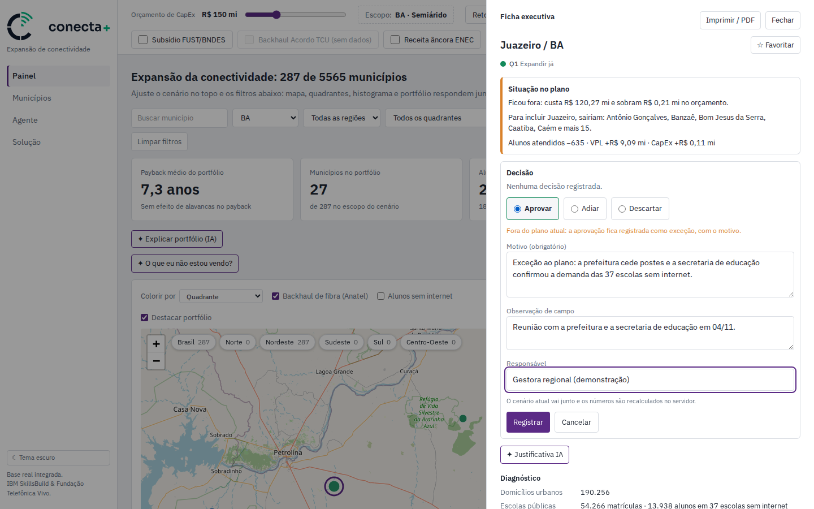

Nada é apagado: uma nova decisão substitui a vigente e o histórico fica na ficha. A tabela de municípios
mostra a decisão de cada um e filtra por aprovados, adiados, descartados ou pendentes.

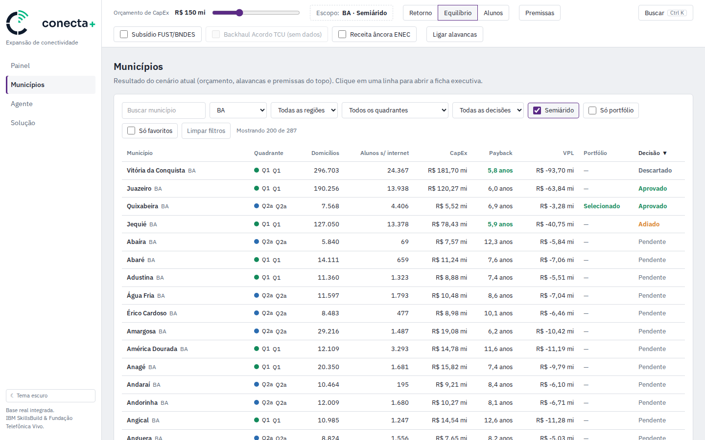

No fim do dia, **Dossiê (PDF)** gera o material do comitê: cenário, resumo do plano com o efeito das
alavancas, decisões registradas (com as exceções marcadas), a tabela dos municípios do plano e os limites
dos dados. Se a leitura do plano ou os achados por IA tiverem sido gerados no Painel, eles entram no
dossiê, assim como a justificativa por IA guardada com cada decisão.

<p align="center">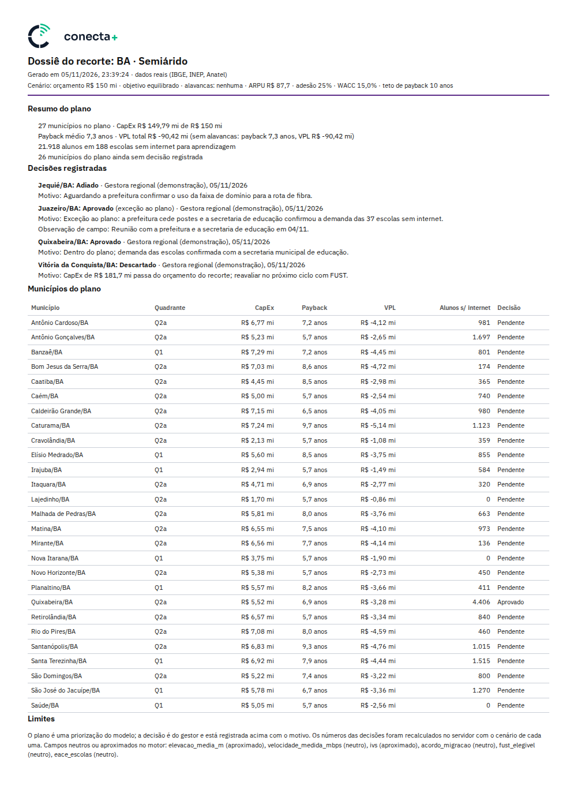</p>

*Dores resolvidas:* decisão sem registro (etapa 4) e material refeito para o comitê (etapa 5).

### 5.4 Perguntar ao agente

O agente conhece a tela (município aberto, orçamento, UF, quadrante, objetivo, alavancas e premissas) e usa ferramentas
do motor: ranking, portfólio, comparação, escolas sem internet, provedores e documentação. A resposta é
redigida pelo IBM Granite sobre os números das ferramentas e mostra as fontes usadas.

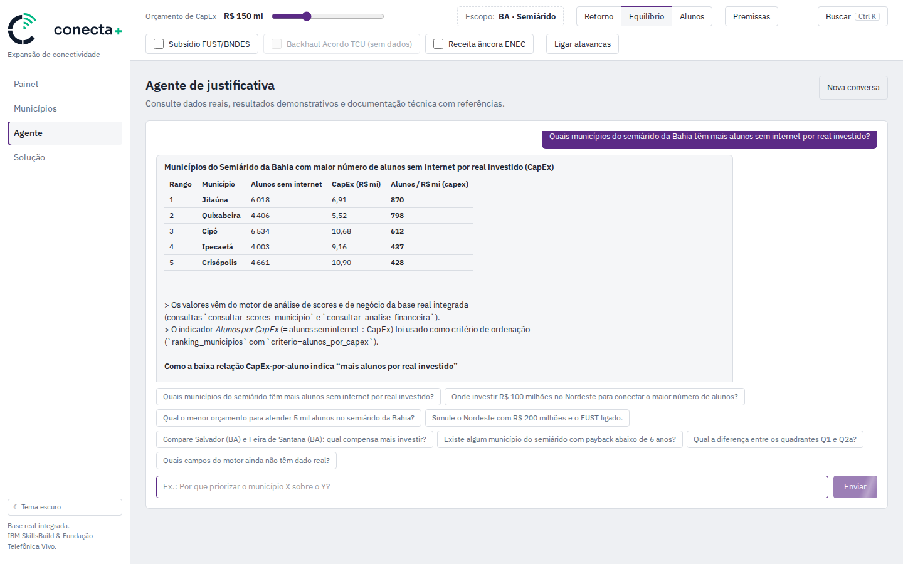

Os números da tabela acima são os do motor: Jitaúna tem 6.018 alunos sem internet e CapEx de R$ 6,91 mi,
ou cerca de 870 alunos por milhão investido.

O agente também é um copiloto do painel. Ele simula alavancas diferentes das da tela ("simule o Nordeste
com R$ 200 mi e o FUST ligado") e responde metas ("qual o menor orçamento para atender 5 mil alunos no
semiárido da Bahia?"): o motor procura o menor orçamento, nos degraus do painel, cujo portfólio atende a
meta. Quando o cenário calculado pode ser reproduzido no painel, a resposta traz o botão **Aplicar no
painel**, que ajusta orçamento, objetivo, alavancas e filtros de uma vez. O botão é montado pelo servidor
com o resultado do motor, não com o texto do modelo.

A conversa não depende da tela: a gestora pode perguntar e seguir para o Painel ou para uma ficha enquanto
o agente trabalha. O menu mostra "pensando…" e, quando a resposta chega, "nova resposta". A conversa
continua lá ao recarregar a página e recomeça com **Nova conversa**.

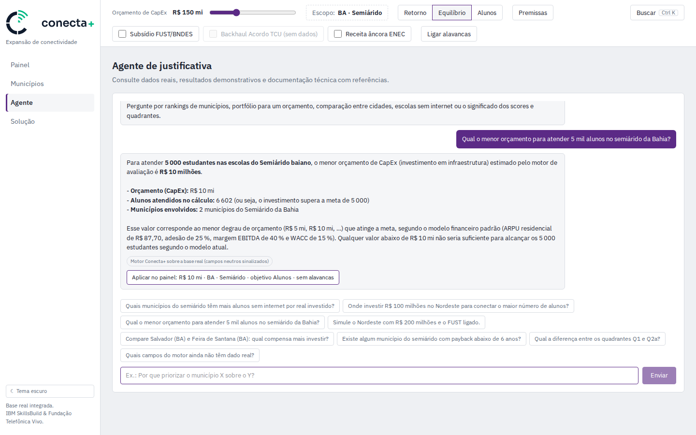

Na resposta acima, o motor chegou a R$ 10 mi: com o objetivo Alunos, o portfólio atende 6.602 alunos em 2
municípios. O botão leva esse cenário ao painel, que mostra os mesmos números.

A paleta **Ctrl+K** navega entre telas, abre fichas pelo nome e transforma um pedido em linguagem natural
em filtros, também com o Granite.

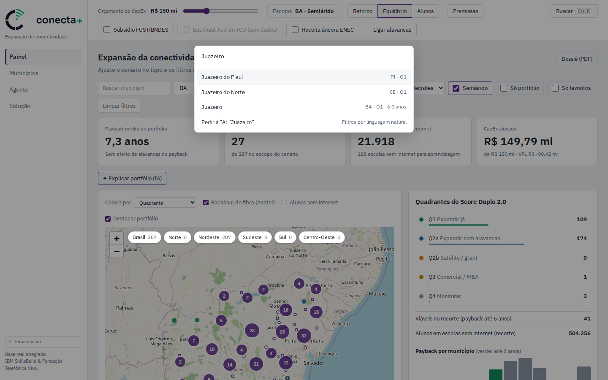

### 5.5 Transparência

A aba **Solução** mostra, com dados da base, o que o Conecta+ faz hoje, o estado de cada parte
(entregue, parcial ou planejado), a composição dos scores, a qualidade de cada fonte, o roadmap e os
limites conhecidos (seção 6). O ROI para a Vivo aparece rotulado como estimativa da proposta.

Para o passo a passo de cada tela, veja o [guia de uso](guia-de-uso.md).

---

## 6. Como funciona

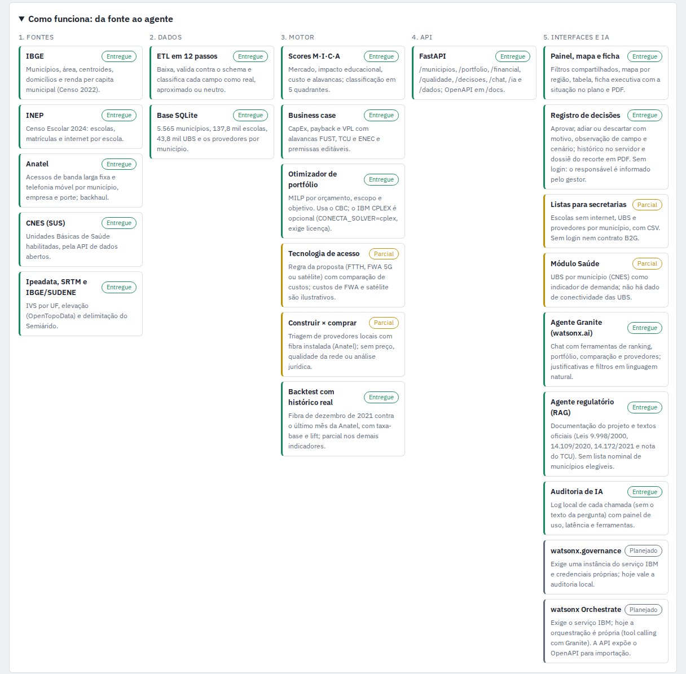

| Camada | O que faz | Tecnologia |
|---|---|---|
| Fontes | IBGE, INEP (Censo Escolar 2024), Anatel, CNES, Ipeadata, SRTM, IBGE/SUDENE | Dados públicos |
| Dados | ETL em 12 passos; valida cada linha contra o schema e classifica cada campo como real, aproximado ou neutro | Python, pandas, Pydantic, SQLite |
| Motor | Scores M·I·C·A e quadrantes; business case (CapEx, payback, VPL); portfólio ótimo; backtest | Python, PuLP + CBC (IBM CPLEX opcional) |
| API | Um cenário único para todas as telas; decisões; IA | FastAPI (OpenAPI em `/docs`) |
| Interfaces e IA | Painel, mapa, ficha, dossiê, chat e paleta | React, Leaflet, IBM Granite no watsonx.ai |

### Onde entra a IBM

- **watsonx.ai / IBM Granite:** três usos. (1) Chat com *tool calling*: o Granite escolhe a ferramenta do
  motor, recebe os números e redige a resposta. (2) Agente regulatório com RAG sobre a documentação do
  projeto e textos oficiais (Leis 9.998/2000, 14.109/2020 e 14.172/2021 e a nota do TCU sobre a solução
  consensual da Telefônica). (3) Textos de uma rodada: justificativa do município, leitura do portfólio,
  filtros em linguagem natural e **achados do cenário**: no Painel, "O que eu não estou vendo?" faz o motor
  procurar o que pode ter passado despercebido (quanto rende um orçamento um pouco maior, o que cada
  alavanca desligada mudaria, municípios fora do plano com mais alunos por real, decisões registradas que o
  plano contradiz) e o Granite escolhe os 3 mais úteis e os redige, cada um com uma ação de um clique.
- **IBM Decision Optimization (CPLEX):** a formulação MILP já está pronta para o CPLEX. Hoje roda com o
  CBC (código aberto); `CONECTA_SOLVER=cplex` troca o solver quando há licença.
- **watsonx Orchestrate e watsonx.governance:** planejados. Hoje a orquestração é própria (tool calling com
  Granite) e a auditoria é um log local; a API expõe o OpenAPI para importação no Orchestrate.

### O motor em uma página

- **Scores (0 a 100):** M (mercado: domicílios, renda, gap de fibra, base móvel, concentração), I (impacto
  educacional: matrículas, ruralidade, déficit de banda, escolas sem internet, IVS), C (custo: distância ao
  backhaul, densidade e elevação, invertido: custo menor, score maior) e A (alavancas: acordo, FUST, EACE).
- **Business case:** payback simples = CapEx / EBITDA de maturidade; VPL com rampa de adesão de 3 anos,
  descontado pelo WACC (ou pelo WACC do FUST quando a alavanca está ligada).
- **Portfólio:** `max Σ xᵢ·[λ·Impactoᵢ + (1−λ)·VPLᵢ]` sujeito a `Σ xᵢ·CapExᵢ ≤ orçamento`, `xᵢ ∈ {0,1}`,
  com teto de payback de 10 anos. O objetivo escolhido (Retorno, Equilíbrio, Alunos) define λ.

Referências: [arquitetura](arquitetura.md), [API](api.md), [referência técnica do motor](engine-technical-reference.md)
e [proposta detalhada](PROPOSTA_DETALHADA.md).

---

## 7. IA confiável

Usamos os pilares de confiança da IBM como checklist.

| Pilar | O que o Conecta+ faz | O que ainda falta |
|---|---|---|
| **Explicabilidade** | Situação no plano em linguagem simples; simulação de inclusão; scores decompostos em M·I·C·A; respostas com as ferramentas usadas | Explicar a sensibilidade de cada score aos pesos |
| **Transparência** | Rótulo real, aproximado ou neutro por campo, na tela e no PDF; referências do RAG em cada resposta; textos de IA marcados com "Revise antes de decidir"; estado de cada parte na aba Solução | watsonx.governance para registro formal do modelo |
| **Robustez** | Números calculados por um motor determinístico com 207 testes automatizados no backend e 23 no front; IA não calcula: recebe fatos já redigidos pelo motor e escreve com temperatura 0; backtest com dados reais | A redação do Granite ainda pode trocar termos ou interpretar mal um score; por isso o texto vem marcado e os números ficam ao lado |
| **Equidade** | Objetivo Alunos ou Equilíbrio coloca o impacto educacional na função objetivo, não só o VPL; recorte do Semiárido | Renda e IVS ainda são por UF e podem esconder desigualdades dentro do estado |
| **Privacidade** | Só dados públicos agregados por município e escola; o log de auditoria não guarda o texto da pergunta | Login e controle de acesso ao registro de decisões |

**Humano no controle.** Uma recomendação do sistema é uma priorização do modelo, não uma decisão de
investimento. A decisão é da gestora, fica registrada com o motivo e as exceções ao plano aparecem como
exceções.

---

## 8. Limites e próximos passos

**Limites conhecidos** (os mesmos que a aba Solução mostra):

- Campos neutros não diferenciam municípios: o score A depende de listas ainda não carregadas (acordo TCU,
  FUST e EACE) e o déficit de banda não tem velocidade medida por município.
- Com as premissas padrão da proposta, o payback simples não cai abaixo de ~5,7 anos e o VPL é negativo.
  As premissas são editáveis.
- Os custos de FWA e satélite são ilustrativos: a recomendação de tecnologia segue a regra da proposta.
- O Censo Escolar 2024 não traz a localização das escolas: a análise é por município.
- O backhaul aparece como presença por município, sem o traçado da rede.
- O registro de decisões não tem login: o responsável é declarado, não verificado, e exige conexão.
- O backtest 2021→2025 acerta só um pouco acima do acaso (lift de 1,13) e é parcial, porque só o acesso
  à fibra é de 2021: os scores precisam de revisão antes de sustentar decisões reais.

**Próximos passos**

| Próximo passo | Depende de |
|---|---|
| Validar persona e Hills com Sponsor Users | Acesso a gestores da Vivo |
| Hill 3: fichas e decisões sem conexão | Resultado do Playback |
| Login, alçada por gestor e fluxo de aprovação | Validar como uma expansão é aprovada hoje |
| Listas oficiais do acordo TCU, FUST e EACE | Publicação em formato aberto ou parceria |
| watsonx Orchestrate e watsonx.governance | Instâncias dos serviços IBM |
| IBM CPLEX em produção | Licença |

---

## 9. Como rodar e equipe

Pré-requisitos: Python 3.11, Node.js 18 e npm 9.

```bash
# Backend (porta 8000)
cd engine
pip install -e ".[dev]"
uvicorn api.main:app --reload

# Frontend (porta 5173), em outro terminal
cd web
npm install
npm run dev
```

Acesse `http://localhost:5173`. A base real é gerada com `python -m etl.run_etl` (em `engine/`); sem ela,
a API usa dados demonstrativos e o app mostra um aviso. As credenciais do watsonx.ai vão em `engine/.env`
(modelo em `engine/.env.example`). Detalhes no [README](../README.md).

**Equipe:** Rafael (scores, financeiro e otimização), Joel (produto e dashboard) e Chris (ETL e agentes
de IA). Divisão de trabalho em [`TEAM.md`](../TEAM.md).
